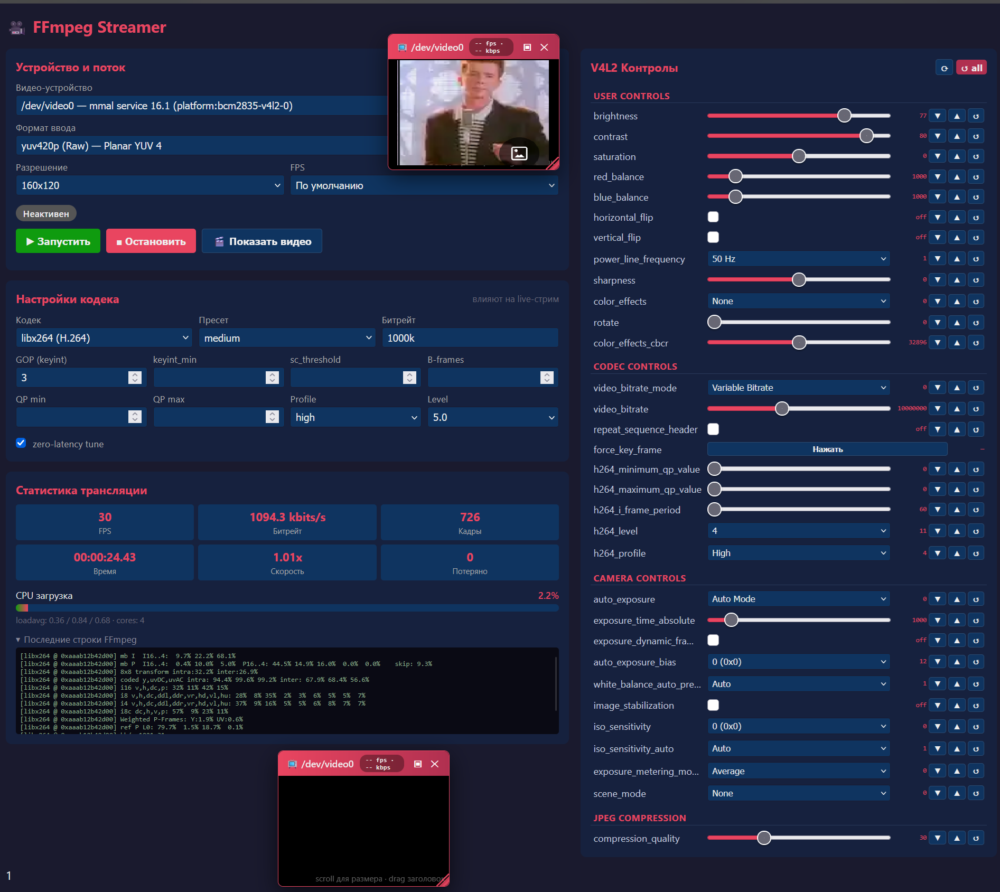

# FFmpeg Streamer

A web-based control panel for capturing video from V4L2 devices, streaming it via FFmpeg, and viewing it live in the browser. Built with Flask and mpegts.js.


---

## Overview

**FFmpeg Streamer** turns any Linux machine with a V4L2-compatible capture device (USB webcam, HDMI capture card, virtual camera, etc.) into a low-latency live streaming server. It provides a browser-based UI to:

- Enumerate `/dev/video*` devices and their supported formats.
- Configure resolution, framerate, codec, bitrate, GOP, and other encoding parameters.
- Read and modify V4L2 hardware controls (brightness, contrast, exposure, etc.) in real time.
- Monitor stream statistics (FPS, bitrate, frames, dropped frames) and CPU load.
- Watch the live stream in a resizable, draggable floating player window.

The video is piped from FFmpeg as MPEG-TS directly to the browser and played back with [mpegts.js](https://github.com/xqq/mpegts.js) over MSE.

---

## Features

- 🎥 **Device & format discovery** — automatic enumeration of V4L2 devices via `v4l2-ctl` and `ffmpeg -list_formats`.
- ⚙️ **Full codec control** — H.264 (`libx264`) with preset, profile, level, GOP, keyint, B-frames, QP bounds, and zero-latency tune.
- 🎛 **V4L2 controls panel** — sliders, dropdowns, checkboxes, step buttons, and per-control / global reset.
- 📊 **Live statistics** — FPS, bitrate, frame count, encoding time, speed, dropped frames, plus CPU usage and load average.
- 🖼 **Floating player** — draggable, resizable, with scroll-to-zoom and saved position.
- 🔌 **Multi-client** — multiple browsers can watch the same stream simultaneously.
- 🚀 **Low latency** — tunable buffer sizes, `zerolatency` tune, and forced IDR period.

---


## Requirements

### System

- Linux with V4L2 support (`/dev/video*` devices)
- Python 3.8+
- **FFmpeg** compiled with `v4l2` and `libx264` support
- **v4l2-ctl** (from the `v4l-utils` package)

Install on Debian/Ubuntu:

```bash
sudo apt update
sudo apt install -y ffmpeg v4l-utils python3 python3-pip
```

### Python packages

```bash
pip install flask
```

---

## Installation

```bash
git clone https://github.com/yourusername/ffmpeg-streamer.git
cd ffmpeg-streamer
pip install -r requirements.txt
```

Directory layout expected by the app:

```
.
├── app.py
├── templates/
│   └── index.html
└── requirements.txt
```

> **Note:** `app.py` uses `render_template('index.html')`, so `index.html` must be placed inside a `templates/` folder next to `app.py`.

---

## Usage

Start the server:

```bash
python3 app.py
```

The web UI will be available at:

```
http://<your-host>:5050
```

### Typical workflow

1. Open the UI in a browser.
2. Select a **video device** from the dropdown.
3. Pick an **input format** and **resolution / FPS**.
4. Adjust **codec settings** if needed (defaults are live-stream friendly).
5. Click **▶ Start**.
6. Click **🎬 Show video** to open the floating player.
7. Tune V4L2 controls on the right while watching the stream.
8. Click **■ Stop** to terminate the FFmpeg process.

---

## Configuration

All configuration is done through the web UI. The available options map directly to FFmpeg CLI arguments:

| UI field | FFmpeg flag | Notes |
|---|---|---|
| Input format | `-input_format` | e.g. `mjpeg`, `yuyv422`, `h264` |
| Resolution | `-video_size` | e.g. `1280x720` |
| FPS | `-framerate` | e.g. `30` |
| Codec | `-vcodec` | `libx264` recommended |
| Preset | `-preset` | `ultrafast` … `medium` |
| Bitrate | `-b:v` / `-maxrate` / `-bufsize` | e.g. `2500k` |
| GOP | `-g` / `-x264-params keyint=` | Keyframe interval |
| keyint_min | `-keyint_min` | Minimum keyframe interval |
| sc_threshold | `-sc_threshold` | Scene change threshold (0 for live) |
| B-frames | `-bf` | 0 for lowest latency |
| QP min/max | `-qpmin` / `-qpmax` | Quantizer bounds |
| Profile | `-profile:v` | `baseline`, `main`, `high` |
| Level | `-level` | e.g. `4.0` |
| zero-latency | `-tune zerolatency` | Disables lookahead buffering |

---

## API Reference

The backend exposes a small JSON API that the frontend consumes. You can also drive it programmatically.

| Method | Endpoint | Description |
|---|---|---|
| `GET` | `/api/devices` | List `/dev/video*` devices with names |
| `GET` | `/api/device/formats?device=/dev/video0` | List supported formats and resolutions |
| `GET` | `/api/controls?device=/dev/video0[&force=1]` | List V4L2 controls |
| `POST` | `/api/controls/set` | Set a control value |
| `POST` | `/api/controls/step` | Increment/decrement a control |
| `POST` | `/api/controls/reset` | Reset one control or all controls |
| `POST` | `/api/stream/start` | Start the FFmpeg stream |
| `POST` | `/api/stream/stop` | Stop the FFmpeg stream |
| `GET` | `/api/stream/status` | Current stream state and statistics |
| `GET` | `/api/cpu` | CPU usage and load average |
| `GET` | `/stream.ts` | MPEG-TS live stream endpoint |

### Example: start a stream

```bash
curl -X POST http://localhost:5050/api/stream/start \
  -H 'Content-Type: application/json' \
  -d '{
    "device": "/dev/video0",
    "input_format": "mjpeg",
    "resolution": "1280x720",
    "framerate": "30",
    "vcodec": "libx264",
    "preset": "ultrafast",
    "bitrate": "2500k",
    "gop": "30",
    "zerolatency": true
  }'
```
---

## License

MIT License. See [LICENSE](LICENSE) for details.

---

## Acknowledgements

- [FFmpeg](https://ffmpeg.org/) — the swiss army knife of video.
- [mpegts.js](https://github.com/xqq/mpegts.js) — MPEG-TS playback in the browser.
- [v4l-utils](https://linuxtv.org/downloads/v4l-utils/) — V4L2 command-line tools.
